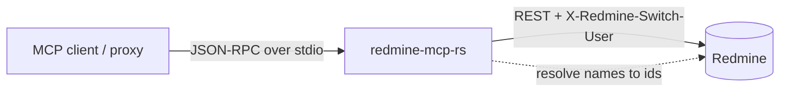

# redmine-mcp-rs

<p>
  
  
  
</p>

A fast, single-binary [Model Context Protocol](https://modelcontextprotocol.io)
server for **Redmine**, written in Rust. It's a behavioural port of the Node
[`redmine-mcp`](https://github.com/mieweb/redmine-mcp) server and speaks MCP over
**stdio** (newline-delimited JSON-RPC 2.0), so any MCP client can use it
unchanged.

> Pairs with [`redmine-mcp-proxy`](https://github.com/mieweb/redmine-mcp-proxy)
> to serve many users over one Streamable-HTTP endpoint with per-user
> impersonation.

---

## Why Rust?

The wire protocol, tool names, and arguments are identical to the Node server —
it's a **drop-in replacement**. Latency is dominated by Redmine REST round-trips,
so raw speed is similar, but the operational wins matter when a proxy spawns one
process per session:

- ⚡ **Fast startup & low memory** — cheap to spin up per user session.
- 📦 **Single static binary** — no Node runtime, no `npx`, no `node_modules`.
- 🔒 **rustls TLS** — no OpenSSL system dependency.

---

## Highlights

- **Admin-key impersonation** via `X-Redmine-Switch-User`
  (`REDMINE_ON_BEHALF_OF`, `REDMINE_LOCK_ON_BEHALF_OF`).
- **Fail-closed** guard for admin keys used without an impersonation identity
  (opt out with `REDMINE_ALLOW_ADMIN=1`).
- **Numeric-zero filter fix** — LLM clients love to send `tracker_id: 0` /
  `priority_id: 0`; these are dropped so the Redmine query isn't corrupted.
- **Human-name resolution** — pass display names, not just ids:
  - `project_id`: `"Bluehive AI"` → `bluehive-ai`
  - `status_id` / `tracker_id` / `priority_id`: `"Bug"`, `"Closed"`, `"High"` → ids
  - `assigned_to_id` / `author_id`: `"Raj Gara"`, `rgara`, `rgara@mieweb.com`,
    or `me` → user id
  - resolved once and **cached** per process.

### Smart user resolution

Redmine's `/users.json?name=` is a loose token search that can return the *wrong*
person for multi-word names. This server resolves **strictly** — exact match on
login, then email, then `"firstname lastname"` — and for multi-word input also
retries on the surname token. If the impersonated (non-admin) user can't list
users, it transparently falls back to the admin key just for the lookup.

---

## How it fits together



---

## Configuration (environment)

| Variable                    | Required | Description                                             |
| --------------------------- | -------- | ------------------------------------------------------- |
| `REDMINE_URL`               | yes      | Base URL, e.g. `https://pm.mieweb.com/`                 |
| `REDMINE_API_KEY`           | yes      | API key (admin key needed for impersonation)            |
| `REDMINE_ON_BEHALF_OF`      | no       | Default user (login or email) to act as                 |
| `REDMINE_LOCK_ON_BEHALF_OF` | no       | `1` to force the env identity and ignore per-call value |
| `REDMINE_ALLOW_ADMIN`       | no       | `1` to allow running as the admin key with no identity  |

---

## Build & run

```sh
cargo build --release

REDMINE_URL="https://pm.mieweb.com/" \
REDMINE_API_KEY="<key>" \
REDMINE_ON_BEHALF_OF="user@example.com" REDMINE_LOCK_ON_BEHALF_OF=1 \
./target/release/redmine-mcp-rs
```

The result is a static binary at `target/release/redmine-mcp-rs`.

### Use it from the proxy

Point the `redmine-mcp-proxy` subprocess spawn at the binary instead of
`node index.js`:

```js
command: "/path/to/redmine-mcp-rs/target/release/redmine-mcp-rs",
args: [],
```

### Use it from a desktop MCP client

```json
{
  "mcpServers": {
    "redmine": {
      "command": "/path/to/redmine-mcp-rs/target/release/redmine-mcp-rs",
      "env": {
        "REDMINE_URL": "https://pm.mieweb.com/",
        "REDMINE_API_KEY": "<your-api-key>"
      }
    }
  }
}
```

---

## Tools

| Tool | Description |
| ---- | ----------- |
| `redmine_list_projects` | List projects |
| `redmine_get_project` | Get a project (id or identifier) |
| `redmine_list_issues` | List/filter issues (names accepted for project/status/tracker/priority/user) |
| `redmine_get_issue` | Get one issue |
| `redmine_create_issue` | Create an issue |
| `redmine_update_issue` | Update an issue |
| `redmine_add_issue_note` | Add a note/comment |
| `redmine_list_users` | List users |
| `redmine_current_user` | Who am I (after impersonation) |
| `redmine_search` | Full-text search |
| `redmine_list_time_entries` | List time entries |
| `redmine_create_time_entry` | Log time |
| `redmine_list_issue_attachments` | List attachments on an issue |
| `redmine_get_attachment` | Fetch attachment metadata/content |

---

## License

MIT
